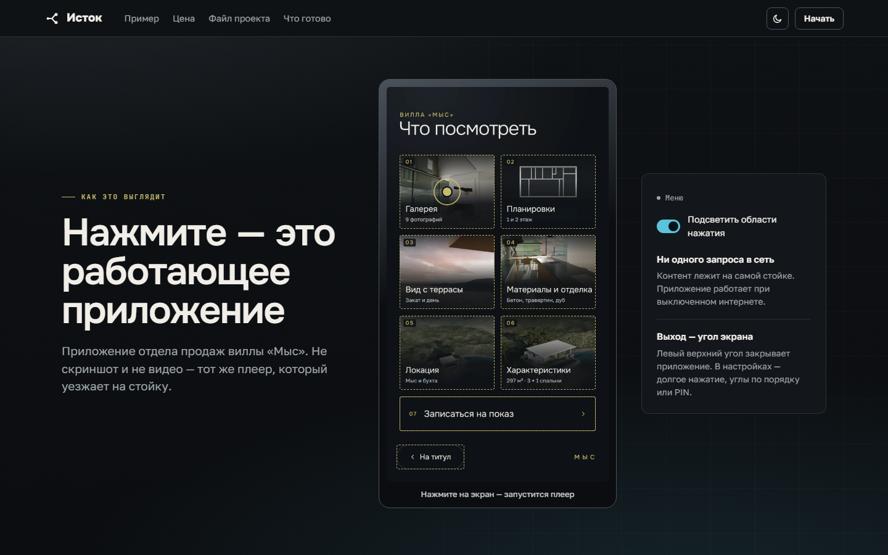
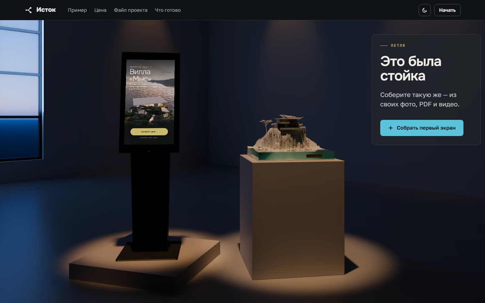
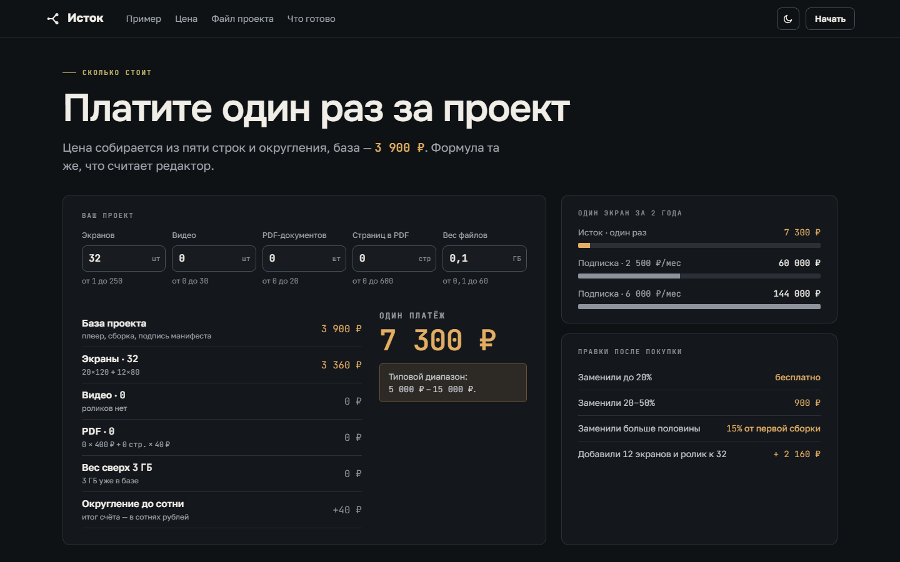
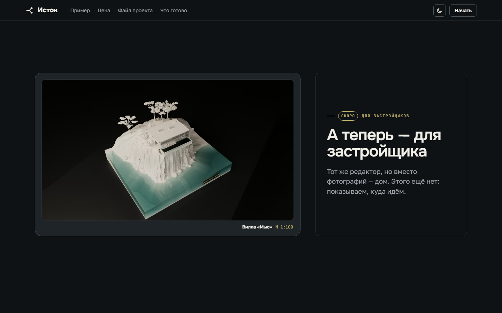
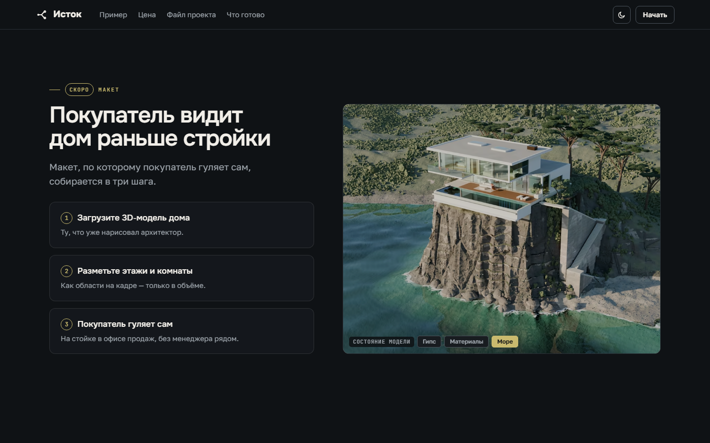
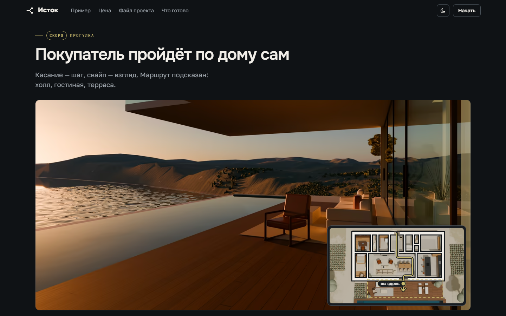

<picture>
  <source media="(prefers-color-scheme: dark)" srcset="images/istok-logo-dark.svg">
  
</picture>

# Исток

**Своё приложение для сенсорного экрана — без программиста и без интернета.**

Вы приносите свои фотографии, видео, PDF и 3D-модель, раскладываете их по
папкам так, как они пойдут на экране, и расставляете кнопки прямо по кадру.
Получаете готовое приложение для сенсорной стойки: оно работает без
интернета и не требует подрядчика, чтобы поменять в нём текст или
фотографию. Платите один раз за проект, а не каждый месяц за экран.

**Страница Истока с живым примером: https://dotnotfact.github.io/istok-about/**

*Живой пример — демо-стенд «Вилла «Мыс»». Это не скриншот и не видео: на
странице Истока его можно потрогать — работает тот же плеер, который уезжает
на стойку.*

---

## Для кого

- **Бизнес — экран, который отвечает за вас.** Меню кофейни у входа, каталог
  магазина или шоурума, стенд на выставке, услуги и навигация в клинике,
  история компании в холле, зал галереи. Соберёте за вечер и поменяете
  сами. Тем, кто сдаёт стойки в прокат или делает выставки, — быстрый способ
  собрать содержимое под каждого клиента и согласовать его ссылкой.
- **Продажи недвижимости — покупатель смотрит сам.** На экране офиса продаж,
  в коттеджном посёлке или шоуруме человек выбирает дом, этаж и квартиру,
  листает галерею, планировки и отделку — а не ждёт, пока менеджер найдёт PDF
  на планшете. Квартиры подсвечены по статусу: свободна, в брони, продана.

Обычно такой экран заказывают студии: месяцы переписки, правки через
подрядчика и приложение, которое без него не поменять. Исток убирает
посредника: приложение собирает тот, кто знает содержание, — маркетолог,
менеджер, дизайнер, сотрудник агентства.

## Как это выглядит

*Так стенд стоит на объекте: сенсорная стойка и приложение, собранное из ваших
фото, PDF и видео.*

*Цена считается при вас и показывается в редакторе на каждое изменение.
Платите один раз за проект — подписки нет.*

## Как это устроено для человека

1. **Папка.** Складываете кадры, видео, PDF и модель так, как они идут на экране.
   Экраны, переходы и названия собираются из структуры папок.
2. **Разметка.** Ставите кнопки мышью прямо по кадру, смотрите превью,
   правите. Превью — это тот же плеер, который уедет на стойку.
3. **Показ заказчику.** Руководитель открывает стенд по ссылке без регистрации,
   оставляет замечания к конкретным экранам и нажимает «Утверждаю».
4. **Приложение.** Забираете готовое приложение и ставите его на стойку.

Редактор, превью и проверки ничего не стоят и не ограничены по числу
проектов. Деньги берутся один раз — когда приложение уезжает на стойку.

## Без обещаний: что есть, что делается, чего нет

### Работает

- **Дерево экранов из папки с материалами** — три дня ручной разметки
  превращаются в проверку готового дерева.
- **Пустой проект одного из трёх видов**: каталог или меню, выставочный
  стенд, офис продаж.
- **Работа без интернета.** Собранное приложение не делает ни одного сетевого
  запроса.
- **Дерево на 200+ экранов.** Раскладку считает сам редактор, узлы не
  таскаются мышью — структуру нельзя сломать случайным движением.
- **Трёхмерная сцена: дом, этаж, квартира.** Модель дома одним файлом и
  постер; касание дома открывает этаж, этажа — квартиру с её карточкой и
  статусом. Где видеокарты нет, стойка показывает постер с обычными
  кнопками. Статусы квартир пока отмечаются вручную.
- **Превью — это и есть плеер.** Сюрприза «в превью было иначе» не будет.
- **Файл проекта переживёт редактор.** У файла есть номер версии, проект,
  собранный сегодня, откроют будущие версии.
- **Файлы остаются на вашем диске.** На сервер кадры уезжают только к сборке.
- **Проект хранится с историей версий** — открыли с другой машины и
  продолжили с того же места.
- **Совместная работа по ссылке.** Соавтор предлагает правку, владелец видит
  разницу и подтверждает.
- **Ссылка заказчику без регистрации** — замечания к экранам и «Утверждаю».
  Поправили экран после утверждения — оно перестаёт действовать, и это видно.
- **Документы для закупки**: коммерческое предложение со сроком цены, счёт и
  акт.
- **Правки считаются по разнице.** До 20% замен после оплаты — бесплатно,
  дальше по шкале.
- **Права до сборки** — четыре отдельных подтверждения: произведения, их
  фотографии, изображённые люди и — если они есть в проекте — музейные предметы.
- **Любое разрешение экрана.** Один проект едет и на 1366×768, и на 4K.
- **Светлая и тёмная тема** — и в редакторе, и в готовом приложении.
- **Докачка больших архивов** с места обрыва.
- **Статистика со стойки и отчёт за период** — какие экраны открывали и
  какие кнопки нажимали; то, что не открыли ни разу, выведено первым. Отчёт
  открывается в Excel.

### Делаем

- **Сборка на сервере с защитой от подмены.** Стойка проверяет подпись при
  запуске; пока не готова дорога, по которой кадры попадают на сервер, и
  обещать оплаченную сборку на сервере работающей мы не будем.
- **Быстрый запуск на старом компьютере** — осталось померить на настоящей
  стойке.
- **Видео под конкретную стойку** — перекодирование под её процессор, прогон на
  эталонной машине впереди.
- **Обновление стойки с флешки** — написано и проверено, прогон с настоящей
  флешкой на настоящей стойке впереди.

### Скоро

- Пересборка без повторной загрузки: на сервер уезжают только заменённые
  файлы.
- Автоматическая разметка кнопок — редактор предлагает области на кадре,
  решает человек.
- Сравнение периодов в отчёте: «до и после» правки стенда.
- Фотобудка: снимок, рамка, печать или QR-код.
- Работа с оборудованием: принтеры, сканер QR, RFID, датчик присутствия,
  терминал оплаты.
- Доступность и звук: озвучивание экранов, крупный шрифт, режим для
  слабовидящих.
- Сборка под Linux и Astra и подача в реестр российского ПО.

### Чего нет

- **Стойка — только Windows 10 и новее.** На Windows 7 и 8 приложение не
  работает и работать не будет.
- **Редактор — Chrome или Edge.** В Firefox и Safari папку с материалами
  придётся выбирать заново после перезагрузки страницы.
- **Одновременной правки одного экрана нет** — соавтор предлагает, владелец
  подтверждает.
- **Тяжёлые PDF готовятся долго** — документ на триста страниц обрабатывается
  несколько минут; мы предупреждаем об этом заранее.
- **Браузер не соберёт стенд тяжелее 2 ГиБ** — такие стенды собирает сервер.
- **Мобильного редактора нет.** С телефона — превью и статус; планшет от
  десяти дюймов уже работает.
- **Связи с 1С и другими системами нет** — содержимое стойки обновляется
  вручную.
- **Панорам 360° не будет.**
- **Магазина модулей не будет.**
- **Маршрутов посетителя и тепловой карты не будет** — это решение: стенд
  стоит в общественном месте, и следить за людьми он не должен.

## Для продаж недвижимости: дом вместо фотографий

Тот же редактор, но вместо фотографий — трёхмерная модель дома. Застройщик
загружает модель, которую уже нарисовал архитектор, отмечает этажи, квартиры
и их статусы, а покупатель сам смотрит дом, этаж и квартиру — на стойке в
офисе продаж, без менеджера рядом. Это уже работает.

Направление, а не функция, — две вещи ниже: срока у них нет.

- **Прогулка по квартире** изнутри, от комнаты к комнате.
- **Статусы квартир из выгрузки** отдела продаж вместо ручной разметки и
  **заявка по QR-коду** со стойки на телефон покупателя.

## Как попробовать

Страница Истока с живым демо-стендом «Вилла «Мыс»»:
**https://dotnotfact.github.io/istok-about/**

## Связаться

Telegram: **https://t.me/istok_kiosk**

Расскажите, что за место или проект и какие материалы уже есть:
фотографии, видео, буклеты в PDF, планировки или 3D-модель. Этого хватает, чтобы сказать, сколько
получится экранов и что стоит доснять.
